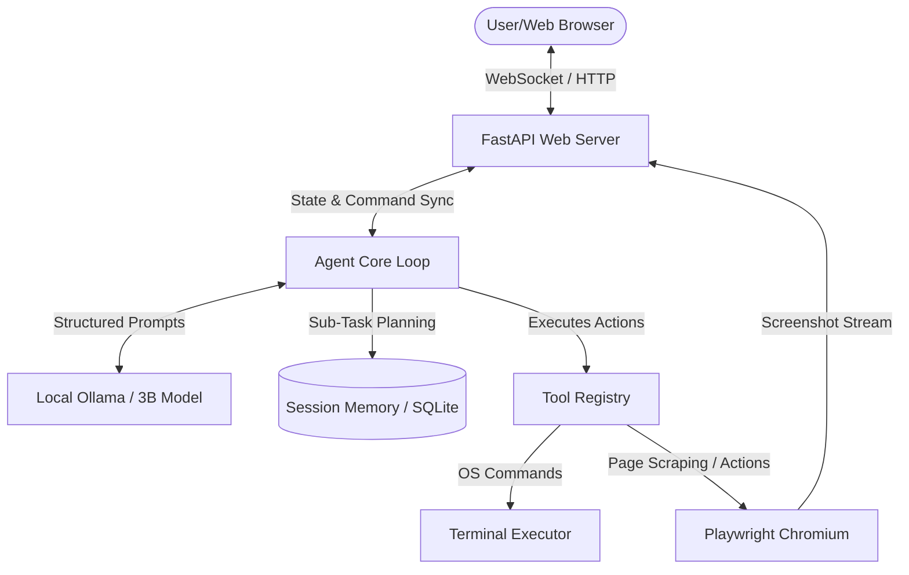

# Project Sovereign: Fully Offline Local Agentic System
## Architectural Blueprint & 20-Phase Implementation Plan

---

## 1. Project Overview & Objectives
**Project Sovereign** is an autonomous, fully offline, agentic AI system designed to run on resource-constrained local hardware (specifically optimized for **1B to 3B parameter models**). The objective is to achieve intelligence levels comparable to larger frontier models (like Gemini 3.5 or Fable 5) on specialized tasks through **advanced cognitive scaffolding**:
1. **Chain-of-Thought (CoT)** reasoning loops.
2. **Self-Reflection and Error Correction** protocols.
3. **Structured Planning & Sub-task decomposition**.
4. **Tool-use autonomy** via terminal, file systems, and Chromium browser control.

### Hardware Target
- **Platform**: Linux (Ubuntu 24.04/26.04) running locally on `~`.
- **Inference Engine**: Ollama or `llama.cpp` using CPU/GPU acceleration.
- **Target Model**: `qwen2.5-coder:3b` or `llama3.2:3b`.
- **Browser Automation**: Chromium managed via Playwright/browser-use.

---

## 2. Multi-Role Development Team
To ensure code quality, reliability, and rigorous verification, our team is structured into 8 distinct roles:
1. **The Planner**: Architect of the system; designs data structures, state machines, and schedules the execution flow.
2. **Coder 1 (LLM & Core Engine)**: Implements model integration, API clients, token-efficiency controls, and structured output parsing.
3. **Coder 2 (Agentic Scaffolding)**: Builds the execution loop, message bus, task planner, and context management.
4. **Coder 3 (Chromium & Tool Runner)**: Focuses on Chromium browser automation, custom terminal runners, and operating system tooling.
5. **Coder 4 (Frontend UI & Realtime Sync)**: Creates a stunning vanilla HTML/JS/CSS dashboard featuring WebSocket synchronization, live browser viewer, and interactive logs.
6. **The Tester**: Writes unit and integration tests, executes validation suites, and ensures safety rails are functional.
7. **The Debugger**: Resolves execution exceptions, handles network timeout failures, fixes syntax errors, and optimizes performance.
8. **The Report Writer**: Maintains `progress.md`, documents architecture, writes changelogs, and updates the task status.

---

## 3. System Architecture

---

## 4. 20-Phase Implementation Roadmap

The development cycle is strictly structured to alternate between **Building**, **Testing**, **Debugging**, and **Verification/Reporting**.

### Phase 1: Project Initialization & Directory Scaffolding
- **Role**: Planner & Report Writer
- **Goal**: Setup folder structures, Git, and virtual environments.
- **Tasks**:
  1. Create folder `~/sovereign_agent`.
  2. Setup Python virtual environment (`.venv`).
  3. Initialize directory layout:
     - `backend/` (FastAPI app)
     - `backend/core/` (Agent logic)
     - `backend/tools/` (Browser & OS tools)
     - `frontend/` (Dashboard assets)
     - `tests/` (Test suites)
  4. Write `progress.md` with base template.

### Phase 2: Local LLM Engine Setup
- **Role**: Coder 1 (LLM & Core)
- **Goal**: Install, configure, and verify the offline local inference engine.
- **Tasks**:
  1. Detect existing Ollama instance or set up local running Ollama server.
  2. Pull target models: `qwen2.5-coder:3b` and `llama3.2:3b`.
  3. Create an LLM client module in python with local endpoint fallback.
  4. Implement context window monitoring to prevent overflow.

### Phase 3: Prompt Engineering & Cognitive Scaffolding
- **Role**: Planner & Coder 1
- **Goal**: Design cognitive structures that elevate a 3B model's performance to match larger models.
- **Tasks**:
  1. Implement a structured Prompt Template engine supporting System, User, and Assistant roles.
  2. Design a **Reason-Act (ReAct)** prompt loop requiring the model to write `<thought>`, `<action>`, `<observation>`, and `<reflection>` blocks.
  3. Formulate JSON schema enforcement prompts to guarantee structured outputs from the 3B model.

### Phase 4: Agent Core Loop & State Machine
- **Role**: Coder 2 (Agentic Scaffolding)
- **Goal**: Build the central execution loop.
- **Tasks**:
  1. Implement the Agent State Machine (Idle, Planning, Executing, Reflecting, Paused, Completed, Failed).
  2. Create the core run loop that cycles through reasoning, action selection, tool execution, and reflection.
  3. Build a session manager to save and resume agent runs.

### Phase 5: Basic System Tools
- **Role**: Coder 2 & Coder 3
- **Goal**: Build the first set of system interaction tools.
- **Tasks**:
  1. Create a `ToolRegistry` decorator class to register tools dynamically.
  2. Implement `read_file`, `write_file`, `list_directory`, and a safe `run_terminal_command` tool.
  3. Add input validation rules to prevent damaging OS-level actions.

### Phase 6: Core System Testing & Benchmarking
- **Role**: The Tester
- **Goal**: Run initial test suites for phases 1-5.
- **Tasks**:
  1. Write unit tests for local LLM inference client connectivity.
  2. Write integration tests for the ReAct loop using a mock model and basic math/file tasks.
  3. Run tool executions to ensure files are modified and listed correctly.
  4. Log test coverage and failures.

### Phase 7: Debugging & Refactoring Phase 1-5 Core
- **Role**: The Debugger & Report Writer
- **Goal**: Resolve bugs identified in Phase 6.
- **Tasks**:
  1. Refactor JSON parser to handle malformed JSON syntax returned by the 3B model (crucial for smaller models).
  2. Fix context length issues by implementing active truncation or summarization.
  3. Log all bug fixes and update `progress.md`.

### Phase 8: Chromium Browser Scaffolding
- **Role**: Coder 3 (Chromium & Tool Runner)
- **Goal**: Install and configure Chromium automation environment.
- **Tasks**:
  1. Install `playwright` in the virtual environment.
  2. Run `playwright install chromium` to fetch offline binaries.
  3. Build a browser controller wrapper to launch Chromium in headless/headed modes, managing cookie folders and session isolation.

### Phase 9: Chromium Browser Tools
- **Role**: Coder 3
- **Goal**: Implement high-level browser actions.
- **Tasks**:
  1. Implement tools: `browser_navigate`, `browser_click`, `browser_type`, `browser_scroll`, and `browser_get_html`.
  2. Implement a screenshot capture utility that returns base64 images for visual reasoning.
  3. Build an HTML clean-up algorithm to strip unnecessary CSS/scripts, minimizing the token payload sent to the 3B model.

### Phase 10: OpenManus-inspired Autonomous Agent Interface
- **Role**: Coder 2 & Coder 3
- **Goal**: Enable fully autonomous browsing and search.
- **Tasks**:
  1. Adapt OpenManus strategies: Create an autonomous agent loop that reads screenshots, plans the next mouse/keyboard click, and executes it.
  2. Add self-correcting mechanisms when a browser element fails to load or click.
  3. Implement search-engine scrapers that work locally without API keys.

### Phase 11: Browser & Autonomous System Testing
- **Role**: The Tester
- **Goal**: Rigorously test browser actions and autonomous tasks.
- **Tasks**:
  1. Spin up a local dummy HTML test page with form inputs, buttons, and dynamic JavaScript content.
  2. Verify the agent can navigate to the page, fill the forms, click buttons, and scrape the success page.
  3. Test screenshot capture and visual page status reading.

### Phase 12: Debugging & Refactoring Browser System
- **Role**: The Debugger & Report Writer
- **Goal**: Fix bugs in browser interactions.
- **Tasks**:
  1. Fix selector issues: implement automatic selector recovery (if a CSS selector fails, fallback to coordinates, text search, or relative positions).
  2. Address memory leaks of unclosed browser tabs/processes.
  3. Update `progress.md` with debugging entries.

### Phase 13: Memory & State Persistence
- **Role**: Coder 2 (Agentic Scaffolding)
- **Goal**: Implement persistent memory across runs.
- **Tasks**:
  1. Set up a local database (SQLite) to store run history, message threads, and step execution metrics.
  2. Build a vector memory helper using a lightweight local embedding database (like FAISS or a simple numpy-based cosine similarity index over JSON) for storing past documents or search results.
  3. Implement a "retrieve memory" tool.

### Phase 14: FastAPI Backend & API Layer
- **Role**: Coder 4 (Frontend & API)
- **Goal**: Expose backend functionality via HTTP and WebSockets.
- **Tasks**:
  1. Create FastAPI application configuration with CORS.
  2. Implement WebSocket endpoints for streaming agent thought logs, execution logs, and screenshots.
  3. Create endpoints to start, pause, stop, and configure agent runs.

### Phase 15: Premium Frontend UI (Dashboard)
- **Role**: Coder 4
- **Goal**: Build a highly polished, responsive web interface.
- **Tasks**:
  1. Create `frontend/index.html` with a premium dark-themed UI (Glassmorphism, dark blue/violet accents, Inter font family).
  2. Design a split-screen layout:
     - Left: Chat history & Live thinking thread.
     - Right: Workspace viewer (Live browser screenshot stream & File explorer).
     - Bottom: Terminal output console showing system command logs.

### Phase 16: Frontend-Backend WebSocket Integration
- **Role**: Coder 4 & Coder 1
- **Goal**: Bind frontend to backend real-time streams.
- **Tasks**:
  1. Implement frontend Javascript WebSocket connection manager.
  2. Render live thoughts using a typed typewriter effect.
  3. Display screenshots dynamically in the browser viewer panel.
  4. Stream real-time CPU/memory and model resource utilization.

### Phase 17: End-to-End System Testing
- **Role**: The Tester
- **Goal**: Verify the entire integrated system end-to-end.
- **Tasks**:
  1. Define 3 complex test scenarios:
     - Task A: Offline research (extract information from local HTML files or offline pages and write a summary markdown file).
     - Task B: Automated system configuration (write a script, run it in terminal, check execution output).
     - Task C: Web task (navigate, search, and parse specific results offline/online).
  2. Verify WebSocket reliability and UI rendering during long-running tasks.

### Phase 18: Debugging & UI/UX Polish
- **Role**: The Debugger & Coder 4
- **Goal**: Polish application interfaces and fix runtime glitches.
- **Tasks**:
  1. Address UI rendering lags when high-frequency logs are received.
  2. Smooth out transitions and scroll behaviors.
  3. Implement custom error-boundary modals if WebSocket disconnects.
  4. Document fixes in `progress.md`.

### Phase 19: Security Sandbox & OS Safeguards
- **Role**: Planner & Coder 3
- **Goal**: Protect the local OS from destructive agent commands.
- **Tasks**:
  1. Implement command filtering (block `rm -rf /`, `sudo`, `dd`, format drives, etc.).
  2. Build a permission verification step in the backend (certain actions prompt the UI for explicit user click approval before continuing).
  3. Test security constraints by feeding malicious user prompts to the agent.

### Phase 20: Final Optimization, Benchmarking & Launch
- **Role**: Coder 1, Tester & Report Writer
- **Goal**: Optimize inference speeds, prepare system manuals, and perform final hand-off.
- **Tasks**:
  1. Measure tokens-per-second, task completion success rate, and CPU/GPU memory footprint.
  2. Create startup scripts (`run.sh`) to start Ollama, FastAPI, and serve the UI in one command.
  3. Write a final usage guide and complete all logs in `progress.md`.

---

## 5. Execution Strategy

We will proceed through these phases sequentially, documenting each step's work, metrics, code files created, and issues encountered in `~/sovereign_agent/progress.md`. All code will be written directly to `~/sovereign_agent`.

*Let the implementation begin.*
